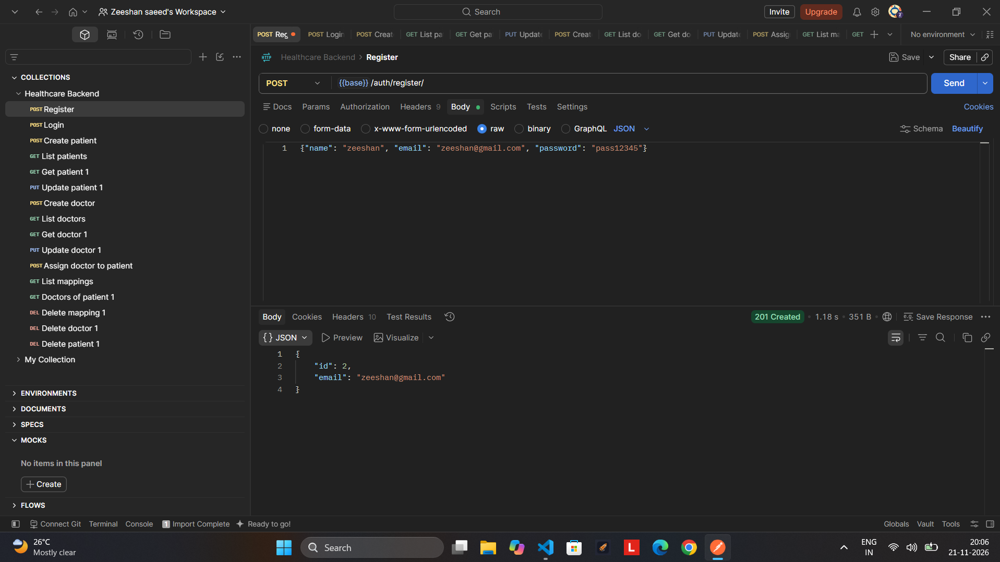
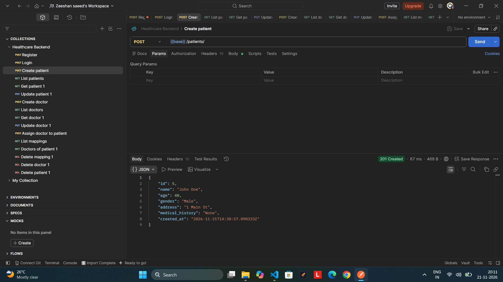
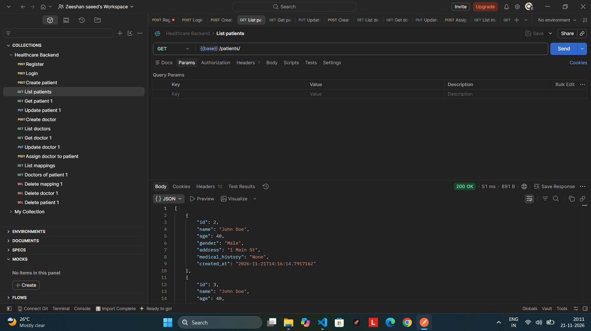
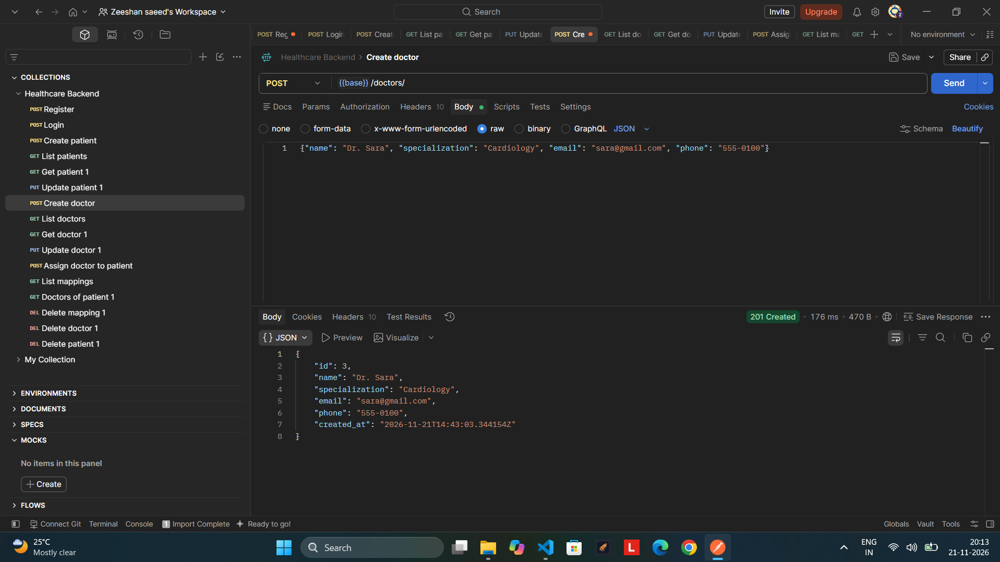
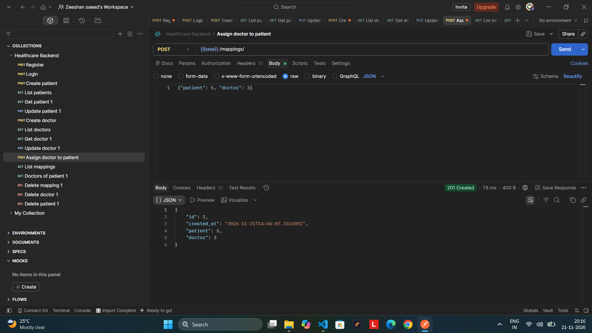

# Healthcare Backend API

A REST API for a healthcare application: users register and log in, manage their own patients and a shared list of doctors, and assign doctors to patients.

**Stack:** Django · Django REST Framework · PostgreSQL · JWT (`djangorestframework-simplejwt`)

## Contents
- [Features](#features)
- [Quick start](#quick-start)
- [API reference](#api-reference)
- [Data model](#data-model)
- [Design decisions](#design-decisions)
- [Testing](#testing)
- [Project layout](#project-layout)

## Features
- Register and log in with email and password; JWT access and refresh tokens.
- **Patients are private**: each user sees and edits only the patients they created.
- **Doctors are shared**: any authenticated user can list them, but only the creator can edit or delete one.
- Assign doctors to patients; duplicate assignments are rejected.
- Input validation with clear error messages and correct HTTP status codes.
- Secrets (secret key, database credentials) come from environment variables, never from code.
- Every endpoint requires authentication except register and login.

## Quick start

### Option A: Docker (one command)
Requires Docker only.
```bash
docker compose up --build
```
PostgreSQL and the API start together and migrations run automatically. The API is served at `http://localhost:8000/api/`. No `.env` is needed; demo credentials live in `docker-compose.yml` and are for local use only.

### Option B: Run locally
Requires Python 3.10+ and PostgreSQL.

1. Create the database:
   ```bash
   createdb healthcare
   ```
2. Install dependencies:
   ```bash
   pip install -r requirements.txt
   ```
3. Create your env file and fill in the values:
   ```bash
   cp .env.example .env
   ```
4. Migrate and run:
   ```bash
   python manage.py migrate
   python manage.py runserver
   ```

### Environment variables
| Name | Required | Purpose |
|---|---|---|
| `SECRET_KEY` | yes | Django secret key |
| `DB_NAME`, `DB_USER`, `DB_PASSWORD` | yes | PostgreSQL credentials |
| `DB_HOST`, `DB_PORT` | no | Default `localhost` / `5432` |
| `DEBUG` | no | `True` for development; defaults to `False` |
| `ALLOWED_HOSTS` | no | Comma-separated; defaults to `localhost,127.0.0.1` |

## API reference
Base URL: `http://127.0.0.1:8000/api`. Send JSON, and send `Authorization: Bearer <access_token>` on everything except register and login.

### Authentication
| Method | Path | Body | Result |
|---|---|---|---|
| POST | `/auth/register/` | `name, email, password` (min 8 chars) | `201` with `id, email` |
| POST | `/auth/login/` | `email, password` | `200` with `access, refresh` |
| POST | `/auth/refresh/` | `refresh` | `200` with a new `access` |

Access tokens are short-lived (5 minutes by default); use the refresh endpoint or log in again when you get `401`.

### Patients (private to the creator)
| Method | Path | Description |
|---|---|---|
| POST | `/patients/` | Create. Fields: `name, age, gender, address, medical_history` |
| GET | `/patients/` | List your patients |
| GET | `/patients/<id>/` | Details of one of your patients |
| PUT | `/patients/<id>/` | Update |
| DELETE | `/patients/<id>/` | Delete (also removes its mappings) |

### Doctors (readable by all, editable by the creator)
| Method | Path | Description |
|---|---|---|
| POST | `/doctors/` | Create. Fields: `name, specialization, email (unique), phone` |
| GET | `/doctors/` | List all doctors |
| GET | `/doctors/<id>/` | Details |
| PUT | `/doctors/<id>/` | Update (creator only, else `403`) |
| DELETE | `/doctors/<id>/` | Delete (creator only, else `403`) |

### Patient–doctor mappings
| Method | Path | Description |
|---|---|---|
| POST | `/mappings/` | Assign. Body: `{"patient": <id>, "doctor": <id>}` |
| GET | `/mappings/` | All mappings for your patients |
| GET | `/mappings/<patient_id>/` | Doctors assigned to that patient |
| DELETE | `/mappings/<id>/` | Remove a mapping (here `<id>` is the **mapping** id) |

### Status codes
| Code | Meaning |
|---|---|
| `200` / `201` / `204` | Success / created / deleted |
| `400` | Validation error (missing field, duplicate email, duplicate mapping, unknown id) |
| `401` | Missing, invalid or expired token, or wrong login credentials |
| `403` | You are not the creator of this doctor |
| `404` | Record does not exist or belongs to another user |

### Example session
```bash
# 1. Register
curl -X POST http://127.0.0.1:8000/api/auth/register/ \
  -H "Content-Type: application/json" \
  -d '{"name": "Jane", "email": "jane@example.com", "password": "pass12345"}'
# {"id": 1, "email": "jane@example.com"}

# 2. Log in and copy the "access" token
curl -X POST http://127.0.0.1:8000/api/auth/login/ \
  -H "Content-Type: application/json" \
  -d '{"email": "jane@example.com", "password": "pass12345"}'

# 3. Create a patient
curl -X POST http://127.0.0.1:8000/api/patients/ \
  -H "Authorization: Bearer <access>" -H "Content-Type: application/json" \
  -d '{"name": "John Doe", "age": 40, "gender": "Male"}'

# 4. Create a doctor, then assign the doctor to the patient
curl -X POST http://127.0.0.1:8000/api/doctors/ \
  -H "Authorization: Bearer <access>" -H "Content-Type: application/json" \
  -d '{"name": "Dr. Smith", "specialization": "Cardiology", "email": "smith@example.com"}'

curl -X POST http://127.0.0.1:8000/api/mappings/ \
  -H "Authorization: Bearer <access>" -H "Content-Type: application/json" \
  -d '{"patient": 1, "doctor": 1}'
```

### Postman
Import `postman_collection.json`. Run **Register**, then **Login** (it stores the token automatically), then the other requests. The collection uses id `1` and fixed emails, so on a database that already has data, change the ids in the URLs and the emails in the bodies to match your records (use the `id` returned by each Create call).

**Results from a Postman run:**

| Register (201) | Create patient (201) |
|---|---|
|  |  |

| List patients (200) | Create doctor (201) |
|---|---|
|  |  |

Assign doctor to patient (201):



## Data model
```
User ──< Patient ──< Mapping >── Doctor >── User
         (created_by)            (created_by)
```
- **Patient**: `name, age, gender, address, medical_history, created_by`
- **Doctor**: `name, specialization, email (unique), phone, created_by`
- **Mapping**: `patient, doctor`, with a unique constraint on the pair, so a doctor can be assigned to a patient only once. A patient can have many doctors and a doctor many patients.
- Deleting a patient or doctor cascades to its mappings.

## Design decisions
- **JWT, stateless auth**: no server-side sessions; the client sends the token on each request.
- **Authenticated by default**: `IsAuthenticated` is the global default permission, and only register and login opt out. A new endpoint is protected unless someone deliberately opens it.
- **404, not 403, for another user's patient**: the API does not reveal whether a record exists.
- **Ownership is set on the server**: `created_by` comes from the token, never from the request body.
- **Mappings are checked against ownership**: you can only assign doctors to your own patients.
- **Email is the username**: login is by email, and emails are compared case-insensitively.

## Testing
```bash
python manage.py test
```
7 tests, all passing against PostgreSQL. They cover:

| Test | What it checks |
|---|---|
| Full flow | register → login → create patient and doctor → assign → list → delete mapping → update patient; duplicate mapping rejected (`400`) |
| Isolation and auth | no token gives `401`; another user's patient gives `404` and is absent from their list |
| Doctor permissions | any user can read a doctor (`200`); a non-creator gets `403` on update and delete; the creator can update and delete |
| Validation errors | negative age and missing gender on a patient give `400`; an invalid doctor email gives `400` |
| Register validation | duplicate email, including a different letter case, gives `400`; a password under 8 characters gives `400` |
| Wrong password | login gives `401` |
| Mapping ownership | you cannot map another user's patient (`400`); their mappings are hidden (`404` / empty list) |

Not covered by automated tests: token refresh, token expiry, and update or delete of mappings by id for other users. The tests use the PostgreSQL settings from `.env` and create and drop their own test database.

## Project layout
```
config/            settings and root URLs
api/models.py      Patient, Doctor, Mapping
api/serializers.py validation and JSON conversion
api/views.py       endpoint logic
api/urls.py        routes
api/tests.py       API tests
postman_collection.json
docker-compose.yml, Dockerfile
```

## Known limitations
- No pagination on list endpoints.
- No roles (for example admin vs. doctor) and no token blacklist on logout.
- Doctor emails are unique across all users.
